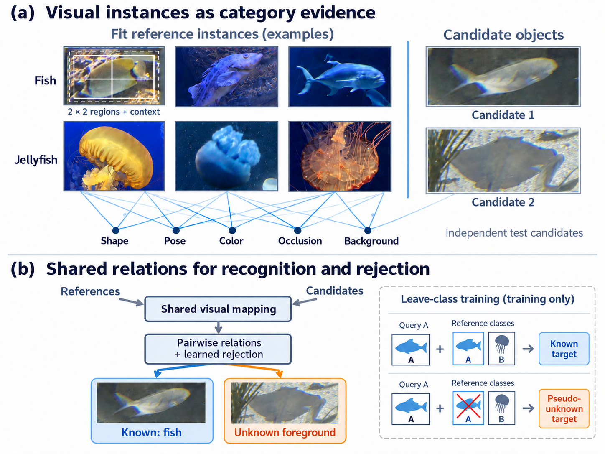
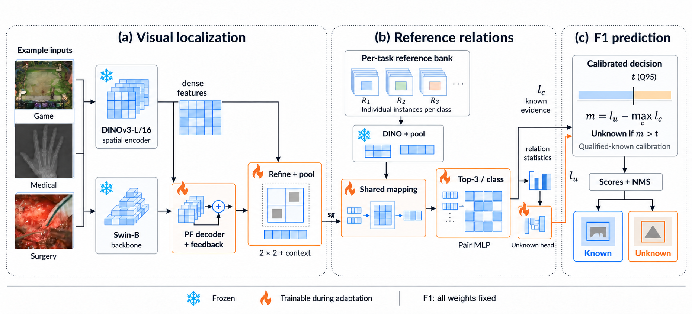

# VRDD

**Visual Reference-Driven Open-World Object Detection**

VRDD turns limited visual annotations into category evidence for known-category recognition and unknown foreground discovery in specialized environments. It connects visual localization feedback, instance-level multi-region reference comparison, leave-class training, and qualified-candidate calibration. Category verification and rejection use visual references without task-category text, attributes, or text prototypes. The purely visual scope concerns the downstream pipeline, not foundation-model pre-training.

[中文说明](README_zh.md) · [Installation](docs/INSTALL.md) · [Data](docs/DATA.md) · [Checkpoints](docs/CHECKPOINTS.md) · [Reproduction](docs/REPRODUCING.md)



## Paper overview

**VRDD: Visual Reference-Driven Open-World Object Detection** (manuscript in preparation).

- **Visual localization:** PF-RPN candidates receive frozen DINOv3 spatial evidence through learned feedback and refinement.
- **Instance-level evidence:** individual fit references retain appearance and context; a shared mapping and top-three-per-class pairwise relations form category evidence.
- **Reference-conditioned rejection:** leave-class episodes teach rejection when the matching reference category is absent. A fixed-scorer, fixed-reference, fixed-threshold bound relates real-unknown false acceptance to pseudo-unknown rejection quality plus a Wasserstein-1 evidence-distribution discrepancy. The discrepancy can be large; the bound is not an unconditional detection guarantee.
- **F1 prediction:** qualified-known calibration sets the identity margin threshold; identity decisions and detection-ranking scores are separated before decoding and NMS.



## Main paper results

Archived VOC07 AP at IoU 0.5 on five RWD domains (percent). These are the designated main-table runs, not multi-seed averages.

| Complete system | Task 1 K | Task 1 U | Task 2 PK | Task 2 CK |
|---|---:|---:|---:|---:|
| CODE L/14 (published) | 40.8 | 21.7 | 43.6 | 36.2 |
| VRDD | **60.4** | **22.1** | **61.4** | **59.5** |
| Difference (percentage points) | +19.6 | +0.4 | +17.8 | +23.3 |

The complete systems use different foundation-model stacks. Controlled internal comparisons establish mechanism effects within their own protocols.

| Paired reference-comparison study | Macro K gain | Macro U gain |
|---|---:|---:|
| DINOv3: D1 minus D0 | +16.08 ± 0.29 | +12.63 ± 2.82 |
| OWL-ViT B/16: O1 minus O0 | +16.93 ± 0.45 | +2.66 ± 0.07 |

Macro gains average Medical, Aquatic, and Game within each seed, then summarize seeds 42/43/44 with mean and sample SD. All nine B/16 domain–seed pairs improve both K and U; this all-pairs claim does not apply to DINOv3. O0/O1 use the frozen OWL-ViT B/16 image encoder on shared native PF-RPN candidates, without a language branch, OWL detection head, or VRDD feedback/refinement/quality modules. Their absolute AP is not comparable with the published complete OWL-ViT detectors in either direction.

See [paper-result scope and L/14 additions](docs/PAPER_RESULTS.md). Detailed setup and release validation status remain below.

## Repository layout

```text
VRDD/
├── run_vrdd.py             # scene/task checkpoint download, bank extraction, inference and evaluation
├── configs/                # model and controlled-experiment configurations
├── src/refnet/             # detector, reference relations, losses and adaptation engine
├── src/refnet_f1/          # qualified-candidate calibration and F1 decoding
├── src/refnet_ablation/    # controlled component ablations and localization analysis
├── src/owl_reference/      # visual-representation transfer study
├── src/current/            # shared progress and runtime helpers
├── versions/              # imported localization/feedback dependencies
├── vendor/                # PF-RPN code and official evaluation implementation, with notices
├── protocols/<scene>/     # locked Task 1 / Task 2 instance and source-group specifications
├── checkpoints/            # small model index; model tensors are downloaded separately
├── results/                # archived formal summary and environment
├── docs/                   # setup, protocol and checkpoint documentation
├── tools/                  # installation/data preparation helpers
├── tests/                  # numerical and release-interface checks
└── provenance/             # source-file checksums and historical experiment provenance
```

## Quick start

1. Follow [installation](docs/INSTALL.md); install a compatible PyTorch/torchvision and MMCV build before the Python requirements.
2. Place the original PF-RPN and DINOv3 backbones as described in [checkpoints](docs/CHECKPOINTS.md).
3. Download the VRDD scene/task model bundle:

```bash
python run_vrdd.py download-weights
python run_vrdd.py check --scene Aquatic --task task1
```

4. Obtain RWD through its original distributor and follow [the dataset layout](docs/DATA.md).
5. Build a legal fit-reference bank and run inference:

```bash
python run_vrdd.py build-bank --scene Aquatic --task task1 --data assets/rwd --device cuda:0
python run_vrdd.py infer --scene Aquatic --task task1 --image /path/to/image.jpg --device cuda:0
```

Predictions are written to `outputs/<scene>/<task>/predictions.json`; the associated `classes.json` maps label IDs to known categories and `unknown`. Boxes are XYXY coordinates in original-image pixels.

For the official test population:

```bash
python run_vrdd.py evaluate --scene Aquatic --task task1 --data assets/rwd --device cuda:0
```

The evaluator preserves the archived VOC07 AP50 implementation. New-device numerical differences may change borderline candidates. Re-evaluations are written separately and do not overwrite the archived summary.

## Models and tasks

The release provides Task 1 and Task 2 weights for **Aquatic, Aerial, Game, Medical and Surgical** (called Surgery in the paper). Each scene/task has its own model, reference identities and calibration:

```text
checkpoints/<scene>/<task>/model.pt
checkpoints/<scene>/<task>/calibration.json
checkpoints/<scene>/<task>/reference_bank.json
```

The same weights are used for known classification and unknown rejection; F1 denotes the calibrated decision rule rather than a separate trained network. Task 2 is joint fitting of old and newly introduced known categories, not exemplar-free continual learning.

## Reproducing experiments

See [REPRODUCING.md](docs/REPRODUCING.md) for original training, F0/F1, component ablations, localization, OWL transfer, candidate diagnostics and runtime measurement entry points. Historical source identities are retained; internal source records are not model filenames. The public scene/task interface is independent of the original workstation paths.

## Release status

This repository contains preserved experiment code and a new portable deployment interface. Source compilation, CPU numerical tests and checkpoint checksums are checked locally. End-to-end GPU execution of the portable interface still requires validation in the target detector environment; it is not claimed as newly benchmarked here.

## License and acknowledgements

Original release code is distributed under the [MIT License](LICENSE). Third-party code, datasets and pretrained models retain their own licenses; see [THIRD_PARTY_NOTICES.md](THIRD_PARTY_NOTICES.md). DINOv3 and PF-RPN backbone weights and RWD images are not redistributed by this code repository.
