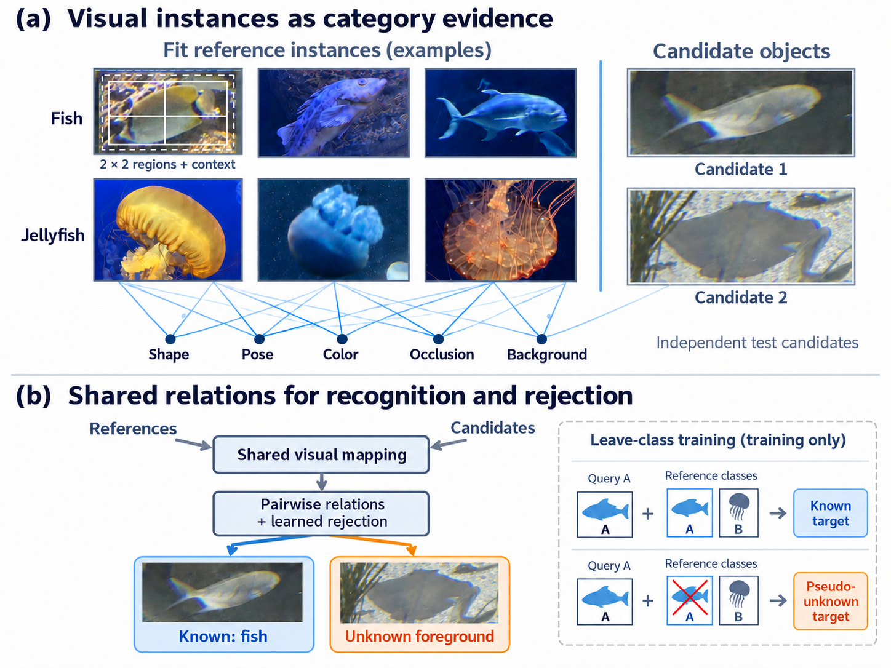
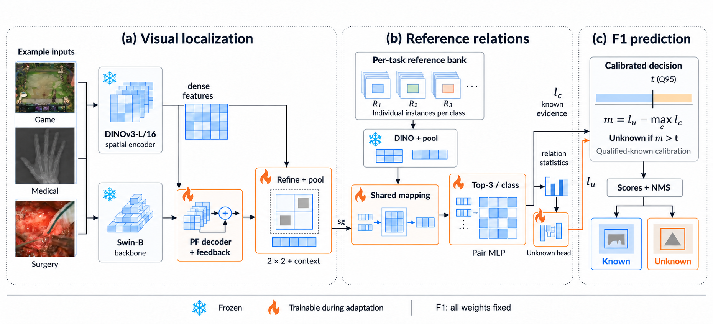

# VRDD：视觉参考驱动的开放世界目标检测

VRDD使用有标注的视觉实例作为类别参考，通过候选定位反馈、实例关系学习与标定拒识完成已知类别识别和未知目标检测。类别验证不需要任务文本或属性提示。

## 当前论文与主要结果

论文题目：**VRDD: Visual Reference-Driven Open-World Object Detection**，当前为工作稿。

VRDD 以有限标注下的已知类别识别和未知前景发现为目标，通过定位反馈、多区域实例描述、共享映射与成对关系、留类训练及候选校准形成完整检测流程。视觉参考保留独立对象实例；“纯视觉”指下游验证与拒识不使用任务文本或属性，不对基础模型的预训练概念覆盖作承诺。

| 五域主表（AP50，%） | K | U | PK | CK |
|---|---:|---:|---:|---:|
| CODE L/14（发表值） | 40.8 | 21.7 | 43.6 | 36.2 |
| VRDD | **60.4** | **22.1** | **61.4** | **59.5** |
| 增益（百分点） | +19.6 | +0.4 | +17.8 | +23.3 |

主表为指定场景/任务运行；完整系统采用不同底座。机制效果由各自协议内的配对对照支持：DINOv3 的 D1−D0 宏平均增益为 K +16.08±0.29、U +12.63±2.82；OWL-ViT B/16 的 O1−O0 为 K +16.93±0.45、U +2.66±0.07。统计先在每个种子内平均 Medical、Aquatic、Game，再对三个种子求均值与样本标准差。

B/16 的九组场景/种子配对在 K、U 上均为正；此结论不扩展为 DINOv3 的全部配对均为正。O0/O1 仅使用冻结 B/16 图像编码器和共享 PF-RPN 候选，不包含语言分支、OWL 检测头或 VRDD 定位反馈、细化和质量模块，绝对 AP 与发表的完整 OWL 系统双向均不可直接比较。

留类拒识的理论上界在固定评分器、参考集合和阈值下，将真实未知误接收率关联到伪未知拒识质量及 Wasserstein-1 分布差异；并非无条件泛化保证。L/14 的 D2/D3 新结果及复现范围见 [PAPER_RESULTS.md](docs/PAPER_RESULTS.md)。





## 从哪里开始

- 环境：[docs/INSTALL.md](docs/INSTALL.md)
- 数据目录与Game纠错：[docs/DATA.md](docs/DATA.md)
- 各场景、各任务的权重：[docs/CHECKPOINTS.md](docs/CHECKPOINTS.md)
- 训练、消融与诊断复现入口：[docs/REPRODUCING.md](docs/REPRODUCING.md)

公开权重按场景和任务命名，例如 `checkpoints/Game/task1/model.pt`。每个模型配套自己的参考对象清单和标定文件，不可跨场景或任务混用。Surgical对应论文里的Surgery。

Git仓库保存代码、配置、协议、轻量结果和说明；大权重单独放在Release中。数据图像、预训练骨干和本机缓存不进入仓库。

```bash
python run_vrdd.py download-weights
python run_vrdd.py check --scene Game --task task1
python run_vrdd.py build-bank --scene Game --task task1 --data assets/rwd --device cuda:0
python run_vrdd.py infer --scene Game --task task1 --image /path/to/image.jpg --device cuda:0
```

`src/refnet`为原网络，`src/refnet_f1`为标定与最终决策；`protocols`保存实例和来源组划分，`results`保存归档摘要。`versions`是模型依赖，保留该结构以避免更改历史数值实现。新推理入口不会改写原训练和评估代码。

F1是决策版本，不是额外的一套训练权重。原始模型和新标注的来源差异在机器可读清单中保留；不把旧模型描述为已在纠错数据上重新训练。Task 2为PK与CK联合拟合。

当前完成代码整理、CPU检查及权重哈希核对；便携入口还需在目标GPU环境验证，不将其当作本轮新增的正式实验成绩。
